# TSM_AdvEmbSof — Advanced Embedded Software

## Project information

- **Institution:** HES-SO Master
- **Program:** MSE — Master of Science in Engineering
- **Course:** TSM_AdvEmbSof — Advanced Embedded Software
- **Academic year:** 2026–2027
- **Group:** Group 1 — Baremetalists
- **Students:**
  - Robin Schaerrer
  - Alexandre Schmid
  - Jean Vallet

## Project description

This repository contains the work for the Advanced Embedded Software course project based on Zephyr RTOS.

The project uses a T3-style Zephyr workspace with the applications stored at workspace level and the west manifest located in `manifest-repo/`. Shared build configurations, board overlays, helper scripts and utilities are provided through `zpp_lib`.

Phase A brings together the work completed in the first four codelabs:

- Zephyr workspace setup and configurable builds
- software quality tooling with `clang-format`, `clang-tidy` and `pre-commit`
- runtime sanitizers and defensive programming
- Kconfig and DeviceTree usage
- automated tests with `ztest` and Twister
- GitHub Actions workflows for quality checks, application builds and tests

The workspace currently uses **Zephyr 4.4.0** and **zpp_lib v1.3**.

## Phase A

Phase A contains three delivered applications and the test applications developed during the codelabs.

### Applications and supported configurations

| Application | Target boards | Supported configurations |
|---|---|---|
| `blinky` | `nrf5340dk/nrf5340/cpuapp`, `qemu_x86` | `gpio`, `log+debug+gpio` |
| `sanitize` | `nrf5340dk/nrf5340/cpuapp`, `qemu_x86` | `shell`, `shell+debug`, `shell+san` |
| `bme280` | `nrf5340dk/nrf5340/cpuapp`, `qemu_x86` | `sensor`, `log+debug+sensor` |

The build matrix is defined in:

`ci/applications_for_build.yaml`

Applications use the shared configuration fragments and board overlays from `zpp_lib`.

### Software quality

The repository includes:

- `.clang-format`
- `.clang-tidy`
- `.pre-commit-config.yaml`
- the dedicated pre-commit GitHub Actions workflow

The application-specific clang-tidy hooks include:

- `clang-tidy-blinky`
- `clang-tidy-sanitize`
- `clang-tidy-bme280`
- `clang-tidy-always-succeed`
- `clang-tidy-ptr-test`

### Testing

The `simple_tests` directory contains the test applications developed with Zephyr's `ztest` framework.

The test configuration is defined in:

`ci/applications_for_test.yaml`

The GitHub Actions workflow:

`.github/workflows/aes-test.yml`

contains jobs for building the applications and running the Twister tests. The workflow is configured for manual execution with `workflow_dispatch`.

---

### Question 1 - Behaviour of the lookup implementations

The goal of this part was to see what happens when the value used to access a lookup table becomes invalid at runtime.

The lookup table is:

`{10, 20, 30, 40, 50, 60, 70, 80}`

and the index is calculated with:

`index = sensor_value - 1`

This means that a sensor value of `1` gives index `0`, while a sensor value of `0` gives index `-1`, which is invalid.

The application provides four lookup implementations:

| Argument | Implementation | Idea |
|---|---|---|
| `0` | `lookup_c_assert` | use an assertion |
| `1` | `lookup_c_safe` | clamp the index |
| `2` | `lookup_cpp` | use `std::array::at()` |
| `3` | `LookUpTable` | check the index and return a fail-safe value |

I tested them with three different builds: production, debug and sanitized.

### Production build

#### `lookup_c_assert`

With a valid value, everything works normally:

`inc 0` gives `1 -> 10`.

When the sensor value becomes `0`, the calculated index is `-1`. Since assertions are disabled in the production build, the invalid array access still happens.

In my case I got values such as `80` and `70`, but these values are not reliable because this is undefined behaviour.

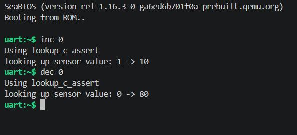

This shows that assertions should not be the only protection against invalid runtime input.

#### `lookup_c_safe`

This version checks the index and clamps it to a valid range.

Even when the sensor value becomes `0` or `-1`, the function still returns `10`.

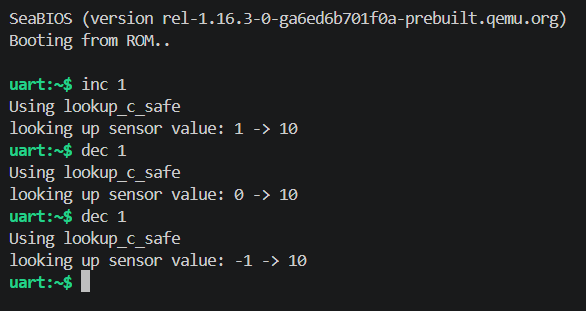

This is safe because there is no invalid array access. The disadvantage is that the invalid input is hidden because it is converted into a valid result.

#### `lookup_cpp`

This version uses `std::array::at()`.

A valid access works normally, but when the index becomes invalid, the application calls `abort()`.

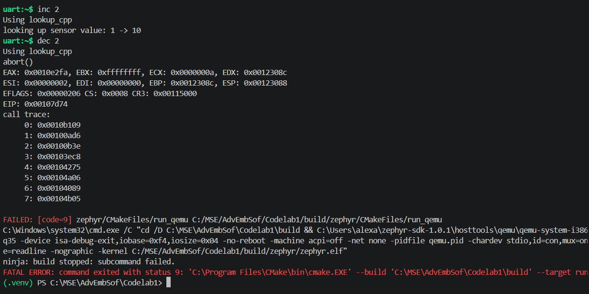

This is safer than directly accessing an invalid index, but the whole application stops.

#### `LookUpTable`

This implementation checks the index manually.

When the index is invalid, it returns the fail-safe value `-1` instead of accessing the array.

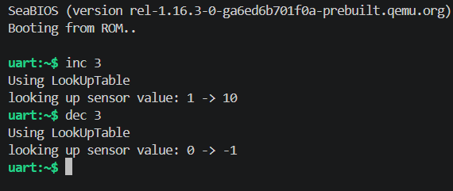

I think this is the most useful behaviour for an embedded application because the error is detected but the application can continue running.

### Debug build

The main difference in the debug build is that assertions are enabled.

#### `lookup_c_assert`

This time the invalid index is detected by the assertion:

`ASSERTION FAIL [idx >= 0 && idx < kLutSize]`

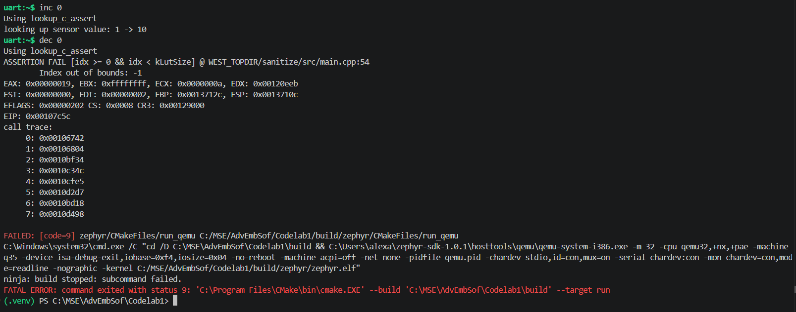

So the debug build catches the problem before the invalid array access happens.

#### `lookup_c_safe`

The behaviour is the same as in production: the invalid index is clamped and the result is `10`.

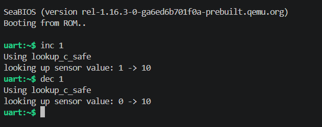

#### `lookup_cpp`

The invalid index is detected by `std::array::at()` and the application aborts.

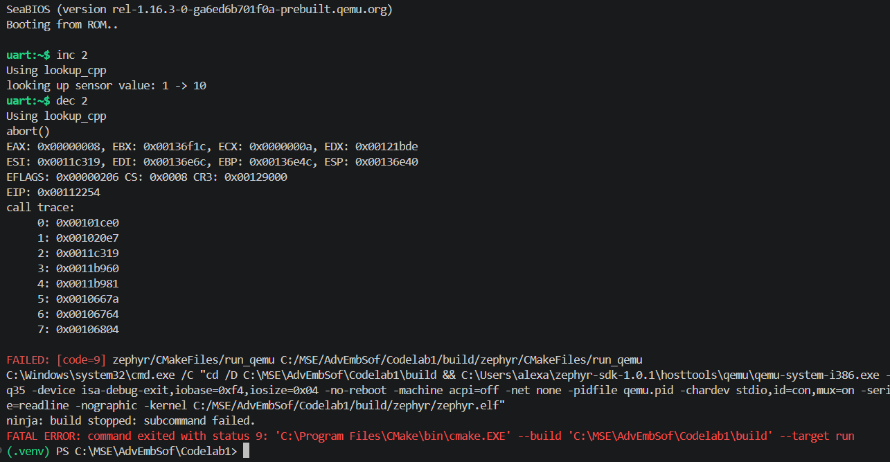

#### `LookUpTable`

The invalid index is detected and `-1` is returned.

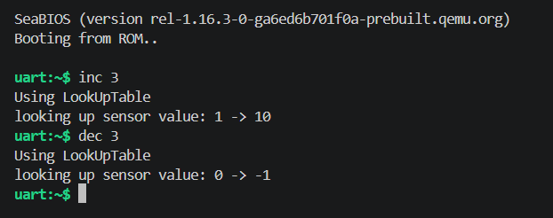

### Sanitized build

In the sanitized build, UBSan is enabled.

I made the sanitizer flags conditional on `CONFIG_UBSAN`, otherwise the production build was also getting sanitized.

#### `lookup_c_assert`

With an invalid index, UBSan detects the problem:

`UBSAN: ERROR out_of_bounds`

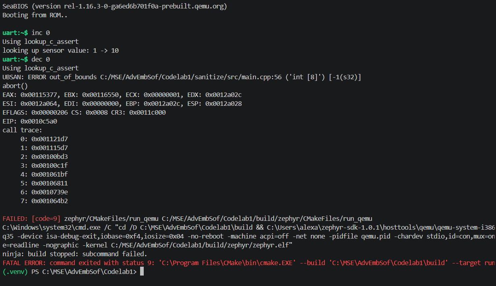

This is interesting because in production the same invalid access just returned a random-looking value.

#### `lookup_c_safe`

No UBSan error is produced because the invalid index is corrected before accessing the array.

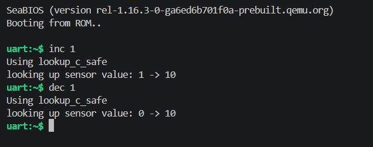

#### `lookup_cpp`

The application still aborts because `std::array::at()` detects the invalid access itself.

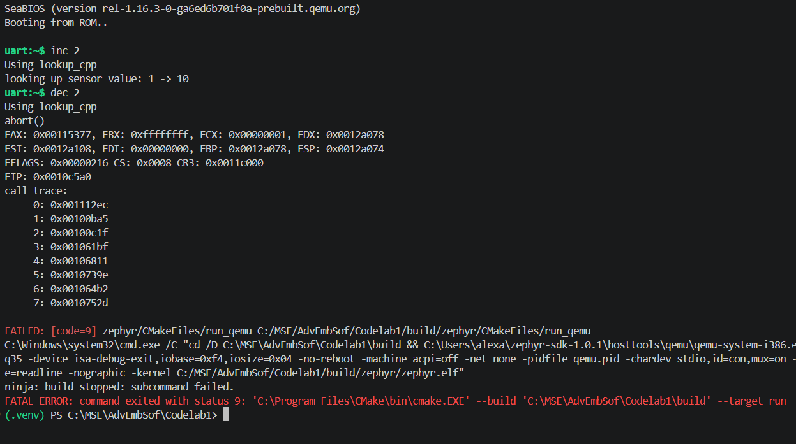

#### `LookUpTable`

The invalid index is detected manually and the function returns `-1`.

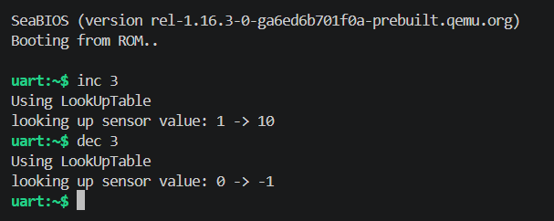

No sanitizer error is produced because no invalid access actually happens.

### Summary

| Implementation | Production | Debug | Sanitized |
|---|---|---|---|
| `lookup_c_assert` | undefined behaviour | assertion aborts | UBSan detects out-of-bounds |
| `lookup_c_safe` | clamps index | clamps index | clamps index |
| `lookup_cpp` | aborts | aborts | aborts |
| `LookUpTable` | returns `-1` | returns `-1` | returns `-1` |

From these tests, the main thing I learned is that assertions are useful during development, but they should not be used as the only runtime protection because they may be disabled in production.

`lookup_c_safe` avoids crashes, but it can hide the fact that the input was invalid.

`lookup_cpp` is safer than an unchecked array access because `at()` performs bounds checking, but it stops the application.

`LookUpTable` gives the most controlled behaviour because it detects the invalid value, returns an error value and keeps the application running.

### Additional runtime bug detected by UBSan

The exercise also asks for another bug that is not detected by `clang-tidy` but is detected at runtime by a sanitizer.

I added an `overflow` shell command which performs:

`result = value + 1`

The value comes from the shell, so `clang-tidy` cannot know which value will be entered at runtime.

I tested the application with:

`just run-clang-tidy sanitize shell+log+debug+san`

and `clang-tidy` completed successfully.

Then I used the maximum signed 32-bit integer:

`overflow 2147483647`

Without the signed integer overflow sanitizer, the result wrapped around to:

`2147483647 + 1 = -2147483648`

To detect this case, I added:

`-fsanitize=signed-integer-overflow`

to the sanitized build.

After rebuilding, running the same command produced:

`UBSAN: ERROR add_overflow`

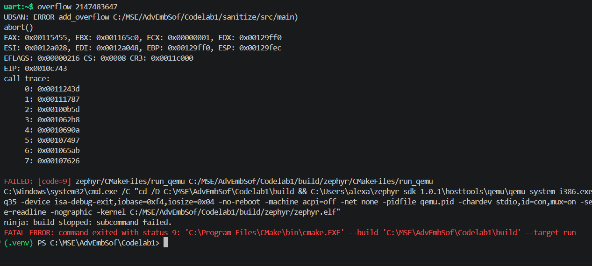

This shows the difference between static analysis and runtime sanitizers quite well.

`clang-tidy` checks the source code without running the program, so it cannot always know what values will be used at runtime.

UBSan checks the program while it is running, so it can detect errors such as the signed integer overflow when they actually happen.

---

## Phase B - Bike Computer - Part 1

### Bikecomputer Static cyclic scheduling exercice

The Bike Computer uses a static cyclic schedule implemented as a super-loop.

The schedule is computed before execution and repeated indefinitely. The
system uses one processor and tasks are non-preemptive: once a task starts, it
runs until it completes.

The scheduling assumptions are:

- All tasks are periodic.
- All computation times are constant.
- The deadline of each task is equal to its period.
- The phase of every task is 0 ms.
- Tasks are independent.
- The Display task may be split into subtasks.

### Task set

| Task | Period (T) | Computation time (C) | Phase |
|---|---:|---:|---:|
| Speed and distance | 400 ms | 200 ms | 0 ms |
| Gear | 800 ms | 100 ms | 0 ms |
| Reset | 800 ms | 100 ms | 0 ms |
| Temperature | 1600 ms | 100 ms | 0 ms |
| Display task 1 | 1600 ms | 200 ms | 0 ms |
| Display task 2 | 1600 ms | 100 ms | 0 ms |

The original Display task has a computation time of 300 ms and a period of
1600 ms. It is split into two subtasks:

- `display_task1()` takes 200 ms.
- `display_task2()` takes 100 ms.

### Selected cycle values

The following values are selected for the static cyclic schedule:

Major cycle: M = 1600 ms  
Minor cycle: m = 400 ms

The following sections verify that these values satisfy the scheduling
requirements.

### Major cycle validation

The major cycle is the time after which the complete schedule repeats.

The selected major cycle is:

M = 1600 ms

For a valid cyclic schedule, `M` must be a common multiple of all task periods.
The smallest common multiple is calculated as follows:

M = lcm(400 ms, 800 ms, 1600 ms)  
M = 1600 ms

The major cycle must also be a multiple of the selected minor cycle:

M = 1600 ms  
m = 400 ms  
M / m = 1600 / 400 = 4

The selected major cycle is a multiple of every task period and contains four
complete minor cycles. Therefore, it is valid.

The number of executions of a task during one major cycle is calculated as:

Number of executions = M / T

| Task | Period | Executions during one major cycle |
|---|---:|---:|
| Speed and distance | 400 ms | 4 |
| Gear | 800 ms | 2 |
| Reset | 800 ms | 2 |
| Temperature | 1600 ms | 1 |
| Display task 1 | 1600 ms | 1 |
| Display task 2 | 1600 ms | 1 |

### Minor cycle validation

The minor cycle is the duration of one frame in the cyclic schedule.

The selected minor cycle is:

m = 400 ms

The following checks validate this value.

#### 1. A task executes at most once per frame

For every task τ<sub>i</sub> , the minor cycle must not be longer than the task period T<sub>i</sub>:

∀ τ<sub>i</sub> ; m <= T<sub>i</sub>

The smallest task period is 400 ms:

m = 400 ms  
T<sub>min</sub> = 400 ms  
400 ms <= 400 ms

This condition is satisfied for every task.

#### 2. Every task fits in one frame

For every task τ<sub>i</sub> , or every subtask when a task is split, the computation time
C<sub>i</sub> must fit inside one minor cycle:

∀ τ<sub>i</sub> ; m >= C<sub>i</sub>

The longest individual task or subtask has a computation time of 200 ms:

m = 400 ms  
C<sub>max</sub> = 200 ms  
400 ms >= 200 ms

This condition is satisfied for every task and subtask.

#### 3. Every task has a frame before its deadline

For every task τ<sub>i</sub> , there must be at least one complete frame in which the task
can execute between its release time and its deadline D<sub>i</sub>:

2m - gcd(T<sub>i</sub>, m) <= D<sub>i</sub>

In this project, D<sub>i</sub> = T<sub>i</sub> for every task.

| Period T<sub>i</sub> | Deadline D<sub>i</sub> | gcd(T<sub>i</sub>, m) | Calculation | Valid |
|---:|---:|---:|---|---|
| 400 ms | 400 ms | 400 ms | 2 x 400 - 400 = 400 ms | 400 ms <= 400 ms |
| 800 ms | 800 ms | 400 ms | 2 x 400 - 400 = 400 ms | 400 ms <= 800 ms |
| 1600 ms | 1600 ms | 400 ms | 2 x 400 - 400 = 400 ms | 400 ms <= 1600 ms |

This condition is satisfied for every task period.

The schedule can therefore use four frames of 400 ms, repeated every 1600 ms.

### Frame allocation

The 1600 ms major cycle is divided into four frames.

| Frame | Time interval | Tasks | Total computation time |
|---|---|---|---:|
| 1 | 0-400 ms | Speed and distance, Gear, Reset | 200 + 100 + 100 = 400 ms |
| 2 | 400-800 ms | Speed and distance, Display task 1 | 200 + 200 = 400 ms |
| 3 | 800-1200 ms | Speed and distance, Gear, Reset | 200 + 100 + 100 = 400 ms |
| 4 | 1200-1600 ms | Speed and distance, Display task 2, Temperature | 200 + 100 + 100 = 400 ms |

Every frame contains exactly 400 ms of computation. Therefore, no frame has
idle time and no task extends into the following frame.

### Deadline verification

For this task set, the deadline is equal to the period:

`D = T`

The absolute deadline of a task instance is:

`Deadline = Phase + (instance number - 1) x Period + Deadline`

| Task instance | Completion time | Absolute deadline | Deadline respected |
|---|---:|---:|---|
| Speed and distance 1 | 200 ms | 400 ms | Yes |
| Speed and distance 2 | 600 ms | 800 ms | Yes |
| Speed and distance 3 | 1000 ms | 1200 ms | Yes |
| Speed and distance 4 | 1400 ms | 1600 ms | Yes |
| Gear 1 | 300 ms | 800 ms | Yes |
| Gear 2 | 1100 ms | 1600 ms | Yes |
| Reset 1 | 400 ms | 800 ms | Yes |
| Reset 2 | 1200 ms | 1600 ms | Yes |
| Display task 1 | 800 ms | 1600 ms | Yes |
| Display task 2 | 1500 ms | 1600 ms | Yes |
| Temperature | 1600 ms | 1600 ms | Yes |

All task instances complete at or before their respective deadlines.

### Schedule validation

The selected cycle values and the frame allocation have been validated.

- The major cycle is a common multiple of every task period.
- The major cycle contains four complete minor cycles.
- Every task or subtask fits entirely in one frame.
- The computation time allocated in every frame is equal to or less than 400 ms.
- No task starts before its release time.
- Every task instance completes at or before its deadline.

Therefore, the task set is schedulable using the selected static cyclic
schedule.

Major cycle: M = 1600 ms  
Minor cycle: m = 400 ms  
Number of frames: M / m = 4

### Implemented schedule

The super-loop implements the four frames in the following order:

```cpp
// Frame 1: 0-400 ms
speed_distance_task();
gear_task();
reset_task();

// Frame 2: 400-800 ms
speed_distance_task();
display_task1();

// Frame 3: 800-1200 ms
speed_distance_task();
gear_task();
reset_task();

// Frame 4: 1200-1600 ms
speed_distance_task();
display_task2();
temperature_task();
```

After frame 4, the super-loop restarts with frame 1.

### Processor utilisation

The processor utilisation is calculated from the original task set:

U = Σ (C<sub>i</sub> / T<sub>i</sub>)

The Display task is counted once with its total computation time of 300 ms.

U = (200 / 400) + (100 / 800) + (100 / 800) + (100 / 1600) + (300 / 1600)  
U = 0.5 + 0.125 + 0.125 + 0.0625 + 0.1875  
U = 1.0 = 100%

The processor utilisation is **100%**. This is consistent with the frame
allocation: each of the four 400 ms frames contains exactly 400 ms of
computation time. Therefore, the processor has no idle time during the
1600 ms major cycle.

### Major cycle timeline

The following diagram shows the complete 1600 ms major cycle.

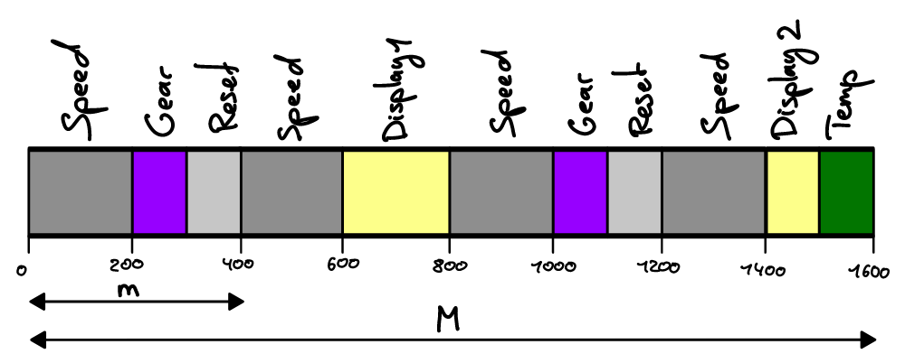


### CPU Load Sensitivity Test Result with Super Loop

**Observation:**
The Part I Super Loop test successfully completed on the physical nRF5340DK with CONFIG_TEST_DURATION_IN_MS=21000.

In a separate execution configured for 22000 ms, the test failed due to a TaskManager timing assertion. The Display(2) task started 81 microseconds beyond the permitted timing tolerance.

**Explanation:**  
The theoretical schedule has a processor utilization of 100%, as each 400 ms frame contains exactly 400 ms of simulated computation.

In practice, additional execution overhead, interrupts and scheduling jitter may introduce small delays. Since the schedule has no nominal slack time, these delays can affect the timing of subsequent tasks.

The experimental results demonstrate that the Super Loop is sensitive to timing deviations. The successful 21 second execution confirms correct behavior over that tested interval, but does not guarantee that every longer execution will meet the timing constraints.

### Question 1 - Response time of the reset event

#### Response time variation:
The system uses a static cyclic schedule (super-loop) where the `reset_task` has an 800 ms period. Although an interrupt immediately records the timestamp of the press, the system only triggers the reset by physically reading the button's state when `reset_task` executes. If the user holds the button and the task executes immediately, the delay is a few milliseconds. If they press just after a task execution, they must hold the button for up to 800 ms until the next cycle, creating a large variation in response time.

#### Missed events:
Because the reset condition relies strictly on polling at the exact moment `reset_task` runs, if the user presses and releases the button between two executions, the polling will read a released state and completely miss the event.

#### Why these behaviors are problematic:
- **Unreliability:** The interface is non-deterministic for the user, who is forced to guess how long to hold the button to ensure their action is registered.
- **Poor User Experience:** A highly variable latency gives the impression of a slow, unstable, or defective device, which is unacceptable for a real-time embedded system.

## Phase B - Bike Computer - Part 2

### Question 1 - CPU load with Busy Waits

**Observation:**  
The observed CPU usage is approximately 99%.

**Explanation:**  
This high load is caused by busy waiting. To simulate task computation times, the program locks the processor in a continuous loop rather than putting it to sleep. Since the CPU is constantly executing instructions, the Zephyr Idle thread never gets a chance to run, resulting in a near 100% CPU load.

### Question 2 - CPU load with Sleep Calls

**Observation:**  
The observed CPU usage is now around 72%.

**Explanation:**  
By using sleep calls, we tell the processor to actually rest when it is waiting, instead of running in an empty loop. The 72% represents the time the processor is genuinely busy doing the work (running the tasks, reading sensors, updating the display). During the remaining 28% of the time, the processor is sleeping, which saves resources.

### CPU Load Sensitivity Test Result with TTCE and Sleep Calls

**Observation:**  
When running the test on the physical board with TTCE and sleep calls (CPU load ~72%), the system runs successfully for approximately **22.5 seconds** before failing due to a `TaskManager` assertion error.

**Explanation:**  
Even with sleep calls reducing the actual CPU load, the theoretical schedule still demands 400 ms of work per 400 ms frame (U = 1). Therefore, the microscopic RTOS overhead delay ε continues to accumulate every cycle. While the sleep mechanisms slightly extend the uptime to 22.5s, the accumulated delay still inevitably exceeds the 100 ticks tolerance. 

This confirms that simply lowering actual CPU usage is insufficient; a static schedule with 100% theoretical utilization remains unsustainable because it provides no slack time for essential OS operations.

### Question 3 - CPU Load with Event-Driven Button Handling

**Observation:**  
The measured CPU load is now approximately 11%.

**Explanation:**  
This drastic reduction in CPU load is the result of shifting from a polling-based approach to an event-driven model, combined with sleep-based scheduling.

1. **Asynchronous Callbacks:** Instead of actively polling the button states, the system now relies on GPIO interrupts (`InterruptIn::add_callback()`). Button presses instantly trigger a callback that sets an atomic flag, handling the event entirely in the background.
2. **Elimination of Busy-Waiting:** Because hardware events are captured by interrupts, the scheduled tasks (`GearDevice`, `PedalDevice`) no longer need to waste CPU cycles in busy-wait loops to check for inputs. They simply consume the atomic flags when it is their turn to run.
3. **Idle Thread Utilization:** With polling removed, tasks execute their core logic quickly. The `TaskManager` then uses sleep calls to wait for the next scheduled execution, allowing the Zephyr Idle thread to take over the CPU.

### Question 4 - Reset Response Time: Polling vs. Event-Driven Handling

**Part I - Polling approach:**  
In Part I, the `reset_task` executes periodically every 800 ms and directly reads the physical state of the button. A reset is only triggered if the button happens to be pressed at the exact moment the task runs. Consequently, short presses occurring between two executions are entirely missed. Additionally, the response time is highly variable, depending on when the user presses the button relative to the 800 ms cycle.

**Part II - Event-driven approach:**  
In Part II, a GPIO interrupt callback (`InterruptIn::add_callback()`) is registered. The moment the button is pressed, the hardware interrupt immediately records the event timestamp and sets an atomic flag in the background. The periodic `reset_task` later consumes this flag. This guarantees that short button presses are never missed, even if the user releases the button before the task executes.

**Response-time comparison:**

| Characteristic | Part I (Polling) | Part II (Event-driven) |
|---|---|---|
| **Button detection** | Periodic physical state check | Instant GPIO interrupt callback |
| **Short presses** | Often missed | Always captured |
| **Reset execution** | Next cycle, if still pressed | Next cycle, if flag is set |
| **Theoretical delay** | 0 to 800 ms (if detected) | 0 to 800 ms |

**Conclusion on Response Time:**
The event-driven architecture drastically improves the reliability of the system by guaranteeing no inputs are lost. However, because the actual reset logic is still bound to the 800 ms static cyclic schedule, the maximum theoretical processing delay remains unchanged.

### CPU Load Sensitivity Test Result with Event-Driven TTCE

**Observation:**  
When running the test on the physical board with the event-driven implementation and sleep calls (CPU load ~11%), the system runs successfully for approximately **51.5 seconds** before failing due to a `TaskManager` assertion error.

**Explanation:**  
Although the actual CPU load dropped to ~11%, the theoretical schedule utilization remains exactly 100% (400 ms of allocated computation per 400 ms frame). With zero slack time, microscopic RTOS overheads - such as context switching and interrupt handling - inevitably accumulate every cycle. After 51.5 seconds, this drift exceeds the strict timing tolerance of the `TaskManager`. 

Ultimately, reducing CPU activity does not fix the underlying issue: a schedule with 100% utilization will always fail because it lacks the margin to absorb natural OS delays.

### Conclusion of Phase B - Part 2

This phase demonstrated the evolution of a Time-Triggered Cyclic Executive (TTCE) schedule:
1. **Busy-Waiting (99% Load):** Highly inefficient, locking the CPU and preventing the OS Idle thread from running.
2. **Sleep Calls (72% Load):** Improved efficiency by allowing the CPU to sleep during simulated computation times, but still heavily burdened by polling tasks.
3. **Event-Driven with Sleep (11% Load):** Maximized efficiency by decoupling hardware inputs (via interrupts) from the schedule, allowing tasks to run only when necessary and letting the processor rest.

**Final Takeaway:** 
The event-driven approach successfully resolves the issue of missed button presses and minimizes unnecessary CPU activity. However, the inevitable crash at 51.5 seconds demonstrates that improving task efficiency is not enough. To build a robust embedded system, we must abandon the rigid TTCE model and transition to a preemptive RTOS scheduler that dynamically manages tasks and provides the necessary slack time to absorb execution overhead.

## Phase C - Multitasking

### Question 1 - Using a mutex in an ISR and Deferring Work

#### 1.1 Mutex access from an ISR with assertions enabled

With the first configuration, when Button 1 is pressed, the interrupt triggers the registered callback, which calls `do_processing_with_cs()` inside the ISR context. This function is normally called by `ButtonThread` inside `perform_work()`, in thread context, where it acquires a mutex to protect the critical section.

When the button is pressed while the thread is executing, the ISR interrupts it and attempts to acquire the same mutex. At the kernel level, when a thread acquires a mutex, Zephyr checks whether it is available and assigns ownership to the calling thread. If the mutex is already locked, the kernel would normally suspend the calling thread and place it in the mutex's pending queue until the mutex becomes available.

However, an ISR cannot be suspended or blocked in this way. Furthermore, the interrupted thread cannot resume execution until the ISR has completed. This could create a deadlock situation, which is why Zephyr prohibits mutex operations inside ISRs.

The kernel checks whether the processor is executing in interrupt context using `arch_is_in_isr()`. Since the assertion `!arch_is_in_isr()` fails, Zephyr triggers a kernel panic and halts the system, producing the mutex assertion error:

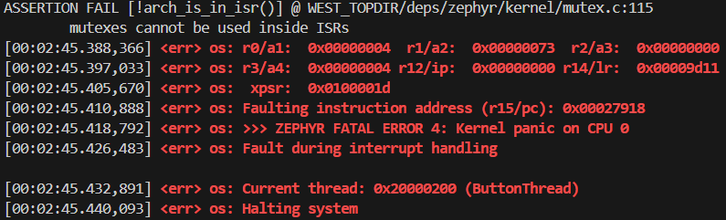

#### 1.2 Mutex access from an ISR with assertions disabled and busy waiting

In this second configuration, when Button 1 is pressed, no assertion failure is detected and the application continues to run because assertions are disabled in this build. Therefore, the previous ISR-context check is not executed when locking the mutex.

If the button is pressed while the mutex is unlocked, `do_processing_with_cs()` acquires the mutex successfully. However, if the mutex is already acquired, the same mutex is acquired recursively, as shown in the output:

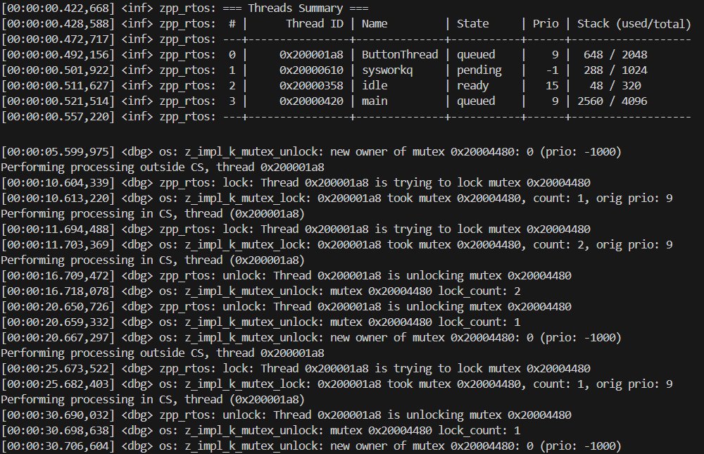

From Zephyr's point of view, both the ISR and `perform_work()` execute with the same thread identity. Therefore, the kernel considers this operation a recursive lock by the existing mutex owner. We can see two occurrences of `Thread 0x200001a8 is trying to lock mutex 0x20004480`. Zephyr supports recursive mutex acquisition, and for this reason, the lock count increases from 1 to 2 instead of blocking.

When the ISR finishes, it unlocks the mutex, decreasing the count to 1. The original thread still owns the mutex and eventually releases it, decreasing the count to 0. This explains why the application does not crash.

However, this behavior is still not correct or safe because the assertion is simply not enabled in this build, so the kernel does not detect and reject the invalid ISR operation. If the ISR interrupted a different thread that owned the mutex, it could attempt to wait for that thread to release it. Since the interrupted thread cannot resume until the ISR finishes, this could result in a deadlock.

#### 1.3 Button press while the thread sleeps outside the critical section

With `CONFIG_WORK_ON_BUTTON_SLEEP=y`, `ButtonThread` enters the sleeping state after finishing its processing outside the critical section. This causes the scheduler to select the idle thread (`0x20000358`) to run.

For this reason, when Button 1 is pressed, we see that the mutex acquisition is attributed to the idle thread: `Thread 0x20000358 is trying to lock mutex 0x20004480`. This happens because the ISR executes in the context of the currently scheduled thread, which is the idle thread.

Since `ButtonThread` has already released the mutex before sleeping, the ISR can acquire the mutex without conflict. The application therefore continues to run without crashing, as shown in the output:

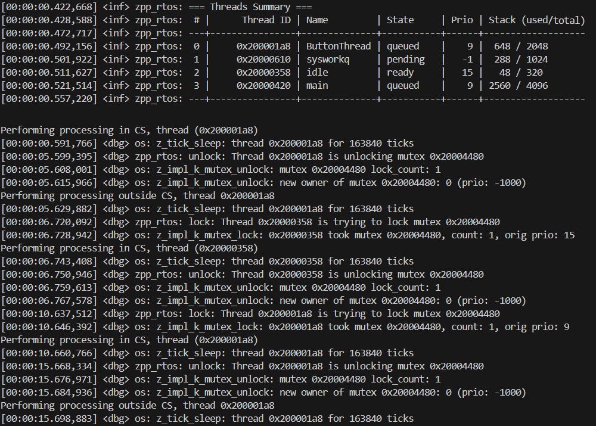

As before, assertions are disabled, so no assertion failure is detected. However, using mutexes inside an ISR is still unsafe and not supported by Zephyr.

#### 1.4 Button press while the thread sleeps inside the critical section

If Button 1 is pressed while `ButtonThread` is sleeping inside the critical section, the system enters a deadlock, as shown in the output:

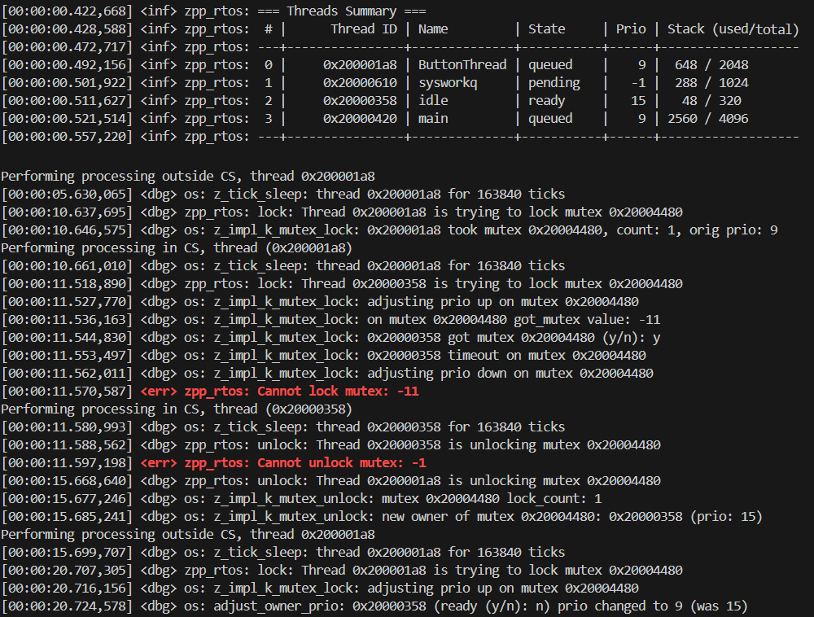

`ButtonThread` has acquired the mutex and is currently sleeping. The scheduler therefore selects the idle thread. Unlike the previous experiment, the mutex has not been released because `ButtonThread` is sleeping inside the critical section. This means that `ButtonThread` is still the mutex owner.

When the button is pressed, the ISR interrupts the idle thread and attempts to acquire the same mutex. At the kernel level, Zephyr detects that the mutex is already owned and attempts to acquire it. Normally, the calling thread would be suspended and placed in the mutex's pending queue until the mutex becomes available. However, the ISR cannot block. The acquisition therefore times out and fails, as shown by the error `Cannot lock mutex: -11`.

Since assertions are disabled, the application continues executing the critical-section function even though the mutex was not successfully acquired. The subsequent attempt to unlock it also fails, producing `Cannot unlock mutex: -1`, because the idle thread is not the mutex owner.

The critical event occurs when `ButtonThread` eventually wakes up and releases the mutex. We can see that the kernel reports the idle thread (`0x20000358`) as the new mutex owner, even though the ISR's acquisition attempt had already failed. This leaves the mutex owned by the idle thread.

When `ButtonThread` subsequently tries to acquire the mutex again, it cannot proceed because the idle thread is still its owner. As a result, `ButtonThread` remains blocked and the application stops making progress, resulting in a deadlock.

If Button 1 is pressed again after the deadlock, the ISR can still execute in the context of the idle thread. Since the idle thread is now considered the mutex owner, the recursive acquisition succeeds and the lock count increases to 2, as shown in the second output:

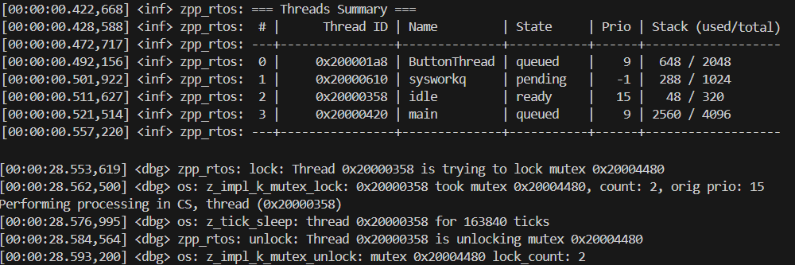

This demonstrates how using mutexes inside an ISR can disrupt the expected synchronization behavior and lead to a deadlock.

#### 1.5 Deferring the work using a work queue

With `CONFIG_WORK_ON_BUTTON_USE_WORK_QUEUE=y`, the application works correctly, whether the button is pressed while `ButtonThread` is inside or outside the critical section, as shown in the output: 

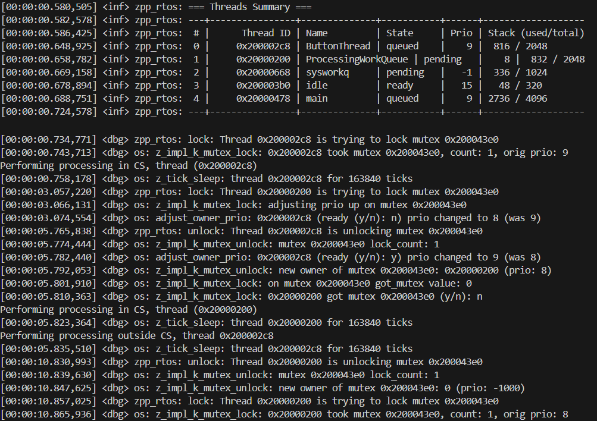

The GPIO callback no longer calls `do_processing_with_cs()` directly. Instead, it submits the work to `ProcessingWorkQueue`. The work queue thread then executes the function in normal thread context, where using a mutex is allowed.

`ProcessingWorkQueue` acquires the mutex when it is available. If `ButtonThread` already owns it, the work queue thread waits until the mutex is released. Once the mutex is unlocked, ownership is transferred to the waiting thread.

Therefore, the work queue safely defers the processing from interrupt context to thread context. This avoids blocking or using a mutex inside the ISR and allows the two threads to synchronize correctly.

### Question 2 - Using a mutex in an ISR and Deferring Work

The following table summarizes the measured interrupt response times for the six scenarios.

| Scenario | Thread priority | Sleep | Measured response time |
|---|---:|---|---|
| 1 | 8 | Yes | 30–62 µs |
| 2 | 9 | Yes | 30–62 µs |
| 3 | 10 | Yes | 30–62 µs |
| 4 | 9 | No | 672 µs–17.6 ms |
| 5 | 8 | No | Approximately 61 µs |
| 6 | 10 | No | No response observed |

#### Scenarios 1, 2 and 3:

When `CONFIG_WAIT_ON_BUTTON_SLEEP` is enabled, the main thread calls `Thread::join()` and waits for the `WaitOnButton` thread to terminate. Since this thread contains an infinite loop, it never terminates, and the main thread remains blocked.

Consequently, the `WaitOnButton` thread does not compete with the main thread for CPU time. Changing its priority between 8, 9 and 10 therefore has no significant impact on the measured response time, which remains between approximately 30 and 62 µs. The small variations are due to interrupt handling and scheduling overhead.

#### Scenario 4:

When `CONFIG_WAIT_ON_BUTTON_SLEEP` is disabled, the main thread executes an infinite busy-wait loop instead of blocking. Both the main thread and the `WaitOnButton` thread have priority 9.

Since both threads have the same priority, they share CPU time through the scheduler's time-slicing mechanism. In our configuration, the time slice is 20 ms. This means that the `WaitOnButton` thread might have to wait until the next time slice to get CPU time and process the button event.

Therefore, depending on when the button is pressed, the expected response time can range from almost 0 ms (if the `WaitOnButton` thread is about to run) to almost 20 ms (if it has just finished its time slice). This explains the large variations in the measured response times, which range from approximately 672 µs to 17.6 ms.

#### Scenario 5:

The `WaitOnButton` thread has priority 8, while the main thread has priority 9. In Zephyr, lower numerical priority values represent higher scheduling priorities. Therefore, the `WaitOnButton` thread has a higher priority and can interrupt the main thread when the button event occurs.

As a result, the event is processed almost immediately, and the response time returns to approximately 61 µs.

#### Scenario 6:

The `WaitOnButton` thread has priority 10, while the main thread has priority 9. The main thread therefore has a higher priority and keeps the CPU occupied through its infinite busy-wait loop.

Since the main thread never blocks or yields, the lower-priority `WaitOnButton` thread never gets CPU time to process the button event. Although the interrupt is still handled and the event is signaled, no response time is printed because the waiting thread never executes.

This behavior is an example of **thread starvation**.
